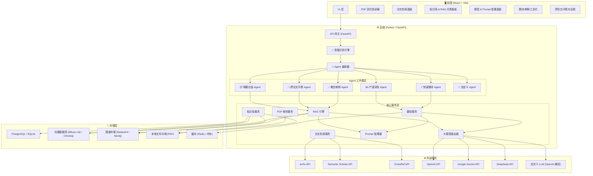
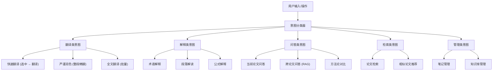
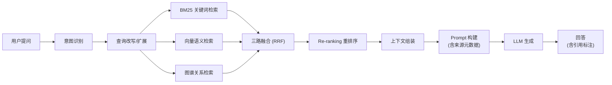
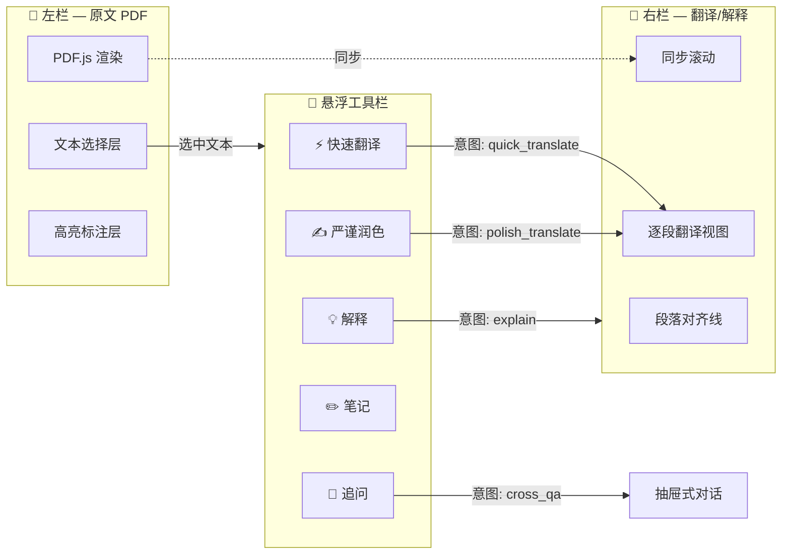

# PDF Reader Agent — 论文阅读智能助手 (v2)

基于 **Python 后端 + React 前端** 的前后端分离架构，集成论文检索、RAG 跨论文知识库、中英对照翻译、多粒度 Prompt 管理、意图识别引擎，以及大模型 API 自定义配置。

---

## 系统总体架构



---

## 技术栈选型

| 层级 | 技术 | 理由 |
|------|------|------|
| **前端框架** | React 18 + Vite | 轻量快速，HMR 极快，与后端完全分离 |
| **前端路由** | React Router v6 | 标准 SPA 路由方案 |
| **前端状态** | Zustand | 轻量级、TypeScript 友好 |
| **UI 样式** | Vanilla CSS + CSS Modules | 灵活控制 PDF 双栏复杂布局 |
| **PDF 渲染** | `react-pdf` (pdf.js) | 成熟方案，支持文本选择与坐标定位 |
| **后端框架** | FastAPI (Python 3.11+) | 异步高性能、自动 OpenAPI 文档、WebSocket 支持 |
| **PDF 解析** | PyMuPDF (`fitz`) + `pdfplumber` | 精确提取文本/坐标/表格/图表 |
| **向量数据库** | Milvus Lite / ChromaDB | Milvus Lite 零依赖嵌入式；Chroma 备选 |
| **Embedding** | `sentence-transformers` (本地) / OpenAI Embedding API | 本地模型零成本，API 可选 |
| **图谱** | NetworkX (本地) / Neo4j (可选) | 论文关系图谱，支持引用链和主题聚类 |
| **关系数据库** | SQLite (默认) / PostgreSQL (可选) | 零配置起步，可扩展 |
| **缓存** | 内存 LRU (默认) / Redis (可选) | 翻译缓存、Embedding 缓存 |
| **任务队列** | `asyncio` + 后台任务 | 长文翻译、批量向量化异步执行 |
| **大模型调用** | 统一适配器 + `httpx` | 异步 HTTP，流式 SSE 支持 |

---

## 模块详细定义

---

### 模块一：意图识别引擎 (`IntentEngine`) 🧠

#### 功能特点
- **多模态意图分类**：根据用户操作上下文（选中文本、点击按钮、输入自然语言）自动识别意图
- **上下文感知**：结合当前阅读位置、历史操作、选中内容判断最佳响应方式
- **意图路由**：将识别结果分发到对应的 Agent 工作模式
- **轻量级分类器 + LLM 兜底**：简单意图用规则/小模型快速分类，复杂意图调用 LLM

#### 意图分类体系



#### 文件结构
```
backend/app/services/intent/
├── __init__.py
├── engine.py                # 意图识别主引擎
├── classifier.py            # 规则 + ML 分类器
├── context.py               # 上下文构建器
├── intent_types.py          # 意图类型枚举与定义
└── router.py                # 意图 → Agent 路由表
```

#### 核心接口
```python
class IntentType(str, Enum):
    QUICK_TRANSLATE = "quick_translate"
    POLISH_TRANSLATE = "polish_translate"
    BATCH_TRANSLATE = "batch_translate"
    TERM_EXPLAIN = "term_explain"
    PARAGRAPH_EXPLAIN = "paragraph_explain"
    FORMULA_EXPLAIN = "formula_explain"
    SINGLE_PAPER_QA = "single_paper_qa"
    CROSS_PAPER_QA = "cross_paper_qa"
    METHOD_COMPARE = "method_compare"
    PAPER_SEARCH = "paper_search"
    SIMILAR_RECOMMEND = "similar_recommend"
    NOTE_MANAGE = "note_manage"
    KB_MANAGE = "kb_manage"

@dataclass
class IntentResult:
    intent: IntentType
    confidence: float
    params: dict              # 提取的参数 (文本、论文ID等)
    context: SessionContext   # 会话上下文
    suggested_agent: str      # 建议的 Agent 模式

class IntentEngine:
    async def recognize(
        self,
        user_input: str,
        context: SessionContext,
        selected_text: str | None = None,
        current_paper_id: str | None = None,
    ) -> IntentResult: ...
```

---

### 模块二：Agent 编排器与多粒度 Prompt 管理 (`AgentOrchestrator` + `PromptManager`) 🤖

#### 功能特点

##### Agent 编排器
- **多 Agent 协同**：根据意图调度单个或多个 Agent 协作完成任务
- **工作流编排**：支持串行/并行 Agent 调用链
- **状态管理**：维护对话上下文、任务进度、中间结果
- **结果聚合**：多 Agent 结果智能合并

##### Prompt 管理器
- **多粒度模板体系**：系统级 / 任务级 / 用户自定义三层 Prompt
- **学术论文专用优化**：避免直译、符合中文学术规范、术语对齐
- **Agent 模式预设**：每种 Agent 绑定专属 Prompt 策略
- **动态变量注入**：上下文、术语表、论文元数据动态填充
- **Prompt 版本管理**：支持 A/B 测试不同 Prompt 效果
- **用户可编辑**：高级用户可自定义/微调 Prompt

#### Agent 工作模式定义

| Agent 模式 | 用途 | Prompt 策略 |
|------------|------|-------------|
| ⚡ **快速翻译** | 选中文本即时翻译 | 流畅通顺、速度优先、保留术语原文 |
| ✍️ **严谨润色** | 段落精翻、学术润色 | 避免直译、符合中文学术表达、术语一致、意译为主 |
| 💡 **概念解释** | 术语/段落/公式解读 | 分层解释（简明→深入）、结合论文上下文 |
| 🔗 **跨论文问答** | RAG 增强的多论文问答 | 引用来源标注、对比分析、综述式回答 |
| 📋 **摘要总结** | 论文摘要/章节总结 | 结构化输出、要点提炼、贡献总结 |
| 🔧 **自定义** | 用户自定义 Agent | 用户配置 Prompt + 参数 |

#### Prompt 模板示例

```python
# 三层 Prompt 架构
PROMPT_LAYERS = {
    "system": {
        # 系统级：定义 Agent 角色与基本行为规范
        "quick_translate": """你是一位精通中英学术翻译的专家。
规则：
1. 保持学术术语的英文原文，首次出现时在译文后括号标注
2. 译文流畅自然，符合中文阅读习惯
3. 数学公式、变量名保持原样
4. 速度优先，不过度润色""",

        "polish_translate": """你是一位资深的学术论文翻译专家，专注于高质量中英翻译。
规则：
1. 避免逐词直译，采用意译策略，确保译文符合中文学术论文的表达规范
2. 严格维护术语一致性，参考提供的术语表
3. 长句拆分、被动句转主动、保持逻辑连贯
4. 数学符号、公式、引用编号保持原样
5. 译文应达到可直接收录中文学术期刊的水准""",

        "concept_explain": """你是一位学术导师，擅长用深入浅出的方式解释复杂学术概念。
规则：
1. 先给出一句话简明解释
2. 再给出详细解读，结合论文上下文
3. 如有必要，提供类比或示例
4. 标注相关的前置知识和延伸阅读方向"""
    },

    "task": {
        # 任务级：定义具体任务的输入输出格式
        "translate_paragraph": "请翻译以下学术段落：\n\n{text}\n\n上下文：{context}\n术语表：{terminology}",
        "explain_term": "请解释以下学术术语在本论文语境中的含义：\n\n术语：{term}\n所在段落：{paragraph}\n论文主题：{paper_topic}",
    },

    "user": {
        # 用户级：用户自定义补充规则（可选）
        # 示例："请使用台湾地区的学术用语习惯"
    }
}
```

#### 文件结构
```
backend/app/services/agent/
├── __init__.py
├── orchestrator.py          # Agent 编排器
├── base_agent.py            # Agent 基类
├── quick_translate_agent.py
├── polish_translate_agent.py
├── concept_explain_agent.py
├── cross_qa_agent.py
├── summary_agent.py
├── custom_agent.py
└── workflow.py              # 工作流定义

backend/app/services/prompt/
├── __init__.py
├── manager.py               # Prompt 管理器
├── templates/               # Prompt 模板文件
│   ├── system/
│   │   ├── quick_translate.md
│   │   ├── polish_translate.md
│   │   ├── concept_explain.md
│   │   ├── cross_qa.md
│   │   └── summary.md
│   └── task/
│       ├── translate_paragraph.md
│       ├── translate_sentence.md
│       ├── explain_term.md
│       ├── explain_paragraph.md
│       └── cross_paper_qa.md
├── variables.py             # 动态变量注入
└── versioning.py            # Prompt 版本管理
```

#### 核心接口
```python
class BaseAgent(ABC):
    """Agent 基类"""
    name: str
    description: str
    prompt_mode: str          # 绑定的 Prompt 模式

    @abstractmethod
    async def execute(self, request: AgentRequest) -> AgentResponse: ...

    async def stream_execute(self, request: AgentRequest) -> AsyncGenerator[str, None]: ...


class AgentOrchestrator:
    """Agent 编排器"""
    async def dispatch(self, intent: IntentResult) -> AgentResponse:
        """根据意图分发到对应 Agent"""
        ...

    async def run_workflow(self, workflow: Workflow) -> AgentResponse:
        """执行多 Agent 工作流"""
        ...


class PromptManager:
    """Prompt 管理器"""
    def build_prompt(
        self,
        mode: str,             # Agent 模式
        task: str,             # 任务模板名
        variables: dict,       # 动态变量
        user_overrides: str | None = None,  # 用户自定义补充
    ) -> list[ChatMessage]: ...

    def list_templates(self) -> list[PromptTemplate]: ...
    def update_template(self, template_id: str, content: str) -> None: ...
    def get_template_versions(self, template_id: str) -> list[PromptVersion]: ...
```

---

### 模块三：RAG 知识库引擎 (`RAGEngine` + `KnowledgeBase`) 📚

#### 功能特点

##### RAG 引擎
- **混合检索**：关键词检索 (BM25) + 语义向量检索 + 知识图谱检索三路融合
- **跨论文问答**：不仅读当前论文，还能检索用户全部历史文献进行综合回答
- **来源标注**：回答中标注引用来源（论文名 + 页码 + 段落）
- **上下文窗口管理**：智能裁剪检索结果，适配 LLM 上下文长度
- **Re-ranking**：二次排序提高检索精度
- **Chunk 策略**：学术论文专用分块（按章节/段落，保留标题层级）

##### 知识图谱 (GraphRAG)
- **论文关系图谱**：自动构建论文间引用关系、方法对比、概念关联
- **实体抽取**：从论文中提取方法名、数据集、指标等实体
- **图谱增强检索**：利用图谱进行多跳推理和关联发现

#### RAG 流程



#### 文件结构
```
backend/app/services/rag/
├── __init__.py
├── engine.py                # RAG 主引擎
├── chunker.py               # 学术论文专用分块器
├── embedding.py             # Embedding 服务（本地/API）
├── bm25_retriever.py        # BM25 关键词检索
├── vector_retriever.py      # 向量语义检索
├── graph_retriever.py       # 图谱关系检索
├── fusion.py                # 多路检索融合 (Reciprocal Rank Fusion)
├── reranker.py              # Re-ranking 重排序
├── context_builder.py       # 上下文窗口组装
└── types.py

backend/app/services/knowledge_base/
├── __init__.py
├── manager.py               # 知识库管理（论文 CRUD）
├── paper_ingestion.py       # 论文摄入管线（解析→分块→向量化→图谱）
├── graph_builder.py         # 知识图谱构建
├── entity_extractor.py      # 实体抽取（方法、数据集、指标）
├── notes.py                 # 笔记管理
├── tags.py                  # 标签/分类管理
└── types.py
```

#### 核心接口
```python
class RAGEngine:
    async def query(
        self,
        question: str,
        paper_ids: list[str] | None = None,   # None = 全库检索
        top_k: int = 10,
        mode: str = "hybrid",                  # hybrid / vector / keyword / graph
    ) -> RAGResult: ...

    async def stream_query(
        self,
        question: str,
        paper_ids: list[str] | None = None,
        top_k: int = 10,
    ) -> AsyncGenerator[str, None]: ...


@dataclass
class RAGResult:
    answer: str
    sources: list[Source]      # 引用来源
    confidence: float

@dataclass
class Source:
    paper_id: str
    paper_title: str
    page: int
    chunk_text: str
    relevance_score: float


class AcademicChunker:
    """学术论文专用分块器"""
    def chunk(self, blocks: list[PDFBlock]) -> list[Chunk]:
        """按章节/段落分块，保留标题层级和元数据"""
        ...

@dataclass
class Chunk:
    id: str
    paper_id: str
    text: str
    section_title: str         # 所属章节标题
    page: int
    chunk_index: int
    metadata: dict             # 标题层级、图表引用等
```

---

### 模块四：论文检索服务 (`SearchService`) 🔍

#### 功能特点
- **多源聚合检索**：arXiv、Semantic Scholar、CrossRef
- **智能排序**：相关度 + 引用数 + 发表日期综合排序
- **一键导入**：下载 PDF 并自动触发知识库摄入管线（解析→分块→向量化→图谱构建）
- **相似论文推荐**：基于当前阅读论文的向量相似度推荐相关文献
- **检索历史**：记录并可回溯

#### 文件结构
```
backend/app/services/search/
├── __init__.py
├── service.py               # 聚合检索入口
├── providers/
│   ├── base.py              # Provider 基类
│   ├── arxiv.py             # arXiv API
│   ├── semantic_scholar.py  # Semantic Scholar API
│   └── crossref.py          # CrossRef API
└── types.py
```

---

### 模块五：PDF 解析服务 (`PDFService`) 📄

#### 功能特点
- **精确提取**：PyMuPDF 提取文本 + 坐标 + 字体信息
- **结构化解析**：段落、标题、图表标注、参考文献分区
- **表格提取**：pdfplumber 提取结构化表格数据
- **分页流式解析**：支持大型 PDF 分页处理
- **坐标映射**：为双栏对照翻译提供精确定位

#### 文件结构
```
backend/app/services/pdf/
├── __init__.py
├── service.py               # PDF 服务入口
├── parser.py                # 文本提取 (PyMuPDF)
├── layout_analyzer.py       # 版面分析
├── table_extractor.py       # 表格提取 (pdfplumber)
├── coordinate_mapper.py     # 坐标映射
└── types.py
```

---

### 模块六：翻译服务 (`TranslationService`) 🌐

#### 功能特点
- **段落/句子/全文翻译**：多粒度翻译
- **双栏对齐展示**：翻译结果与原文段落精确对齐
- **术语一致性引擎**：自动维护全文术语表，确保术语统一
- **翻译缓存**：已翻译内容持久化缓存，避免重复调用
- **流式输出**：SSE 流式推送翻译结果
- **与 Prompt 管理器集成**：根据 Agent 模式使用不同翻译策略

#### 文件结构
```
backend/app/services/translation/
├── __init__.py
├── service.py               # 翻译服务入口
├── paragraph_translator.py  # 段落翻译
├── sentence_translator.py   # 句子翻译
├── batch_translator.py      # 全文批量翻译
├── terminology.py           # 术语一致性引擎
├── cache.py                 # 翻译缓存
└── types.py
```

---

### 模块七：大模型路由器 (`LLMRouter`) 🔌

#### 功能特点
- **统一异步接口**：所有模型调用通过统一 `async` 接口
- **多模型适配器**：内置 OpenAI、Gemini、DeepSeek 适配器
- **自定义 API**：支持任意 OpenAI 兼容 API（base_url + api_key + model）
- **流式支持**：SSE 流式输出
- **自动回退**：主模型失败时切换备用
- **用量统计**：Token 用量、调用次数、延迟统计
- **连接池**：`httpx.AsyncClient` 连接池复用

#### 文件结构
```
backend/app/services/llm/
├── __init__.py
├── router.py                # 路由器主逻辑
├── adapters/
│   ├── base.py              # 适配器基类 (ABC)
│   ├── openai_adapter.py
│   ├── gemini_adapter.py
│   ├── deepseek_adapter.py
│   └── custom_adapter.py    # 通用 OpenAI 兼容
├── config.py                # 配置管理
└── types.py
```

---

### 模块八：前端 UI (`React + Vite`)

#### 页面结构

| 页面 | 路由 | 功能 |
|------|------|------|
| 知识库首页 | `/` | 论文列表、标签分类、阅读进度、语义搜索 |
| 论文检索 | `/search` | 多源检索、结果展示、一键导入 |
| PDF 阅读器 | `/reader/:id` | 双栏阅读、翻译、解释、笔记 |
| 跨论文问答 | `/chat` | RAG 问答对话、来源引用展示 |
| 设置 | `/settings` | 模型配置、Prompt 模板编辑、偏好设置 |

#### PDF 双栏阅读器核心交互



#### 前端文件结构
```
frontend/
├── index.html
├── vite.config.ts
├── package.json
├── tsconfig.json
│
├── src/
│   ├── main.tsx                     # 入口
│   ├── App.tsx                      # 根组件 + 路由
│   │
│   ├── api/                         # API 调用层
│   │   ├── client.ts                # Axios / Fetch 封装
│   │   ├── papers.ts                # 论文相关 API
│   │   ├── translation.ts           # 翻译相关 API
│   │   ├── search.ts                # 检索相关 API
│   │   ├── rag.ts                   # RAG 问答 API
│   │   ├── config.ts                # 模型配置 API
│   │   └── prompts.ts               # Prompt 管理 API
│   │
│   ├── pages/
│   │   ├── HomePage/                # 知识库首页
│   │   ├── SearchPage/              # 论文检索
│   │   ├── ReaderPage/              # PDF 阅读器
│   │   ├── ChatPage/                # 跨论文问答
│   │   └── SettingsPage/            # 设置
│   │
│   ├── components/
│   │   ├── pdf-viewer/
│   │   │   ├── BilingualViewer.tsx       # 双栏阅读器主组件
│   │   │   ├── OriginalPane.tsx          # 左栏原文
│   │   │   ├── TranslationPane.tsx       # 右栏翻译
│   │   │   ├── SelectionToolbar.tsx      # 悬浮工具栏
│   │   │   ├── SyncScrollManager.tsx     # 同步滚动
│   │   │   └── pdf-viewer.module.css
│   │   │
│   │   ├── chat/
│   │   │   ├── ChatWindow.tsx
│   │   │   ├── MessageBubble.tsx
│   │   │   ├── SourceCitation.tsx        # 引用来源标注
│   │   │   └── chat.module.css
│   │   │
│   │   ├── search/
│   │   ├── knowledge-base/
│   │   ├── settings/
│   │   │   ├── ModelConfigForm.tsx
│   │   │   ├── PromptEditor.tsx          # Prompt 模板编辑器
│   │   │   └── settings.module.css
│   │   │
│   │   └── ui/                          # 通用组件
│   │
│   ├── stores/                          # Zustand 状态
│   │   ├── pdf-store.ts
│   │   ├── translation-store.ts
│   │   ├── chat-store.ts
│   │   ├── search-store.ts
│   │   └── config-store.ts
│   │
│   └── styles/
│       ├── globals.css                  # 全局样式 + 设计 tokens
│       ├── theme.css                    # 暗色/亮色主题
│       └── animations.css              # 动画
```

---

## 完整项目目录总览

```
pdf_reader/
├── backend/                          # Python 后端
│   ├── app/
│   │   ├── main.py                   # FastAPI 应用入口
│   │   ├── config.py                 # 全局配置
│   │   ├── database.py               # 数据库连接
│   │   │
│   │   ├── api/                      # API 路由层
│   │   │   ├── __init__.py
│   │   │   ├── papers.py             # /api/papers
│   │   │   ├── search.py             # /api/search
│   │   │   ├── translation.py        # /api/translation
│   │   │   ├── explain.py            # /api/explain
│   │   │   ├── rag.py                # /api/rag
│   │   │   ├── config.py             # /api/config
│   │   │   └── prompts.py            # /api/prompts
│   │   │
│   │   ├── services/                 # 业务逻辑层
│   │   │   ├── intent/               # 意图识别
│   │   │   ├── agent/                # Agent 编排
│   │   │   ├── prompt/               # Prompt 管理
│   │   │   ├── rag/                  # RAG 引擎
│   │   │   ├── knowledge_base/       # 知识库
│   │   │   ├── search/               # 论文检索
│   │   │   ├── pdf/                  # PDF 解析
│   │   │   ├── translation/          # 翻译服务
│   │   │   └── llm/                  # 大模型路由
│   │   │
│   │   ├── models/                   # SQLAlchemy / Pydantic 模型
│   │   │   ├── paper.py
│   │   │   ├── note.py
│   │   │   ├── translation_cache.py
│   │   │   ├── model_config.py
│   │   │   ├── prompt_template.py
│   │   │   └── search_history.py
│   │   │
│   │   └── utils/                    # 工具函数
│   │
│   ├── data/
│   │   ├── papers/                   # PDF 文件存储
│   │   ├── db/                       # SQLite 数据库文件
│   │   └── cache/                    # 缓存文件
│   │
│   ├── requirements.txt
│   ├── pyproject.toml
│   └── alembic/                      # 数据库迁移 (可选)
│
├── frontend/                         # React 前端
│   ├── src/
│   ├── public/
│   ├── package.json
│   ├── vite.config.ts
│   └── tsconfig.json
│
├── docker-compose.yml                # 可选：容器化部署
└── README.md
```

---

## 数据库设计 (SQLAlchemy + SQLite)

```python
# backend/app/models/paper.py
class Paper(Base):
    __tablename__ = "papers"
    id: str                    # UUID
    title: str
    authors: str               # JSON list
    abstract: str
    year: int
    source: str                # arxiv / semantic_scholar / local
    source_id: str
    file_path: str
    tags: str                  # JSON list
    added_at: datetime
    last_read_at: datetime
    read_progress: float       # 0.0 - 1.0
    is_indexed: bool           # 是否已向量化入库

# backend/app/models/translation_cache.py
class TranslationCache(Base):
    __tablename__ = "translation_cache"
    id: str
    paper_id: str              # FK → papers
    block_id: str
    original_text: str
    translated_text: str
    mode: str                  # quick / polish
    agent_mode: str            # 使用的 Agent 模式
    model_used: str
    created_at: datetime

# backend/app/models/note.py
class Note(Base):
    __tablename__ = "notes"
    id: str
    paper_id: str              # FK → papers
    block_id: str
    page_number: int
    content: str
    note_type: str             # highlight / annotation / question
    position: str              # JSON bbox
    created_at: datetime

# backend/app/models/model_config.py
class ModelConfig(Base):
    __tablename__ = "model_configs"
    id: str
    name: str
    provider: str              # openai / gemini / deepseek / custom
    api_key: str               # 加密存储
    base_url: str
    model: str
    max_tokens: int
    temperature: float
    is_default: bool
    total_tokens_used: int
    total_calls: int

# backend/app/models/prompt_template.py
class PromptTemplate(Base):
    __tablename__ = "prompt_templates"
    id: str
    agent_mode: str            # quick_translate / polish_translate / ...
    layer: str                 # system / task / user
    name: str
    content: str
    version: int
    is_active: bool
    created_at: datetime
    updated_at: datetime

# backend/app/models/search_history.py
class SearchHistory(Base):
    __tablename__ = "search_history"
    id: str
    query: str
    filters: str               # JSON
    results_count: int
    searched_at: datetime

# 知识图谱实体表
class KGEntity(Base):
    __tablename__ = "kg_entities"
    id: str
    paper_id: str              # FK → papers
    entity_type: str           # method / dataset / metric / concept
    name: str
    description: str

# 知识图谱关系表
class KGRelation(Base):
    __tablename__ = "kg_relations"
    id: str
    source_entity_id: str      # FK → kg_entities
    target_entity_id: str      # FK → kg_entities
    relation_type: str         # cites / compares / extends / uses
    paper_id: str
```

---

## API 路由设计

| 方法 | 路由 | 说明 |
|------|------|------|
| **论文管理** | | |
| GET | `/api/papers` | 获取论文列表 |
| POST | `/api/papers/upload` | 上传 PDF |
| GET | `/api/papers/{id}` | 获取论文详情 |
| DELETE | `/api/papers/{id}` | 删除论文 |
| GET | `/api/papers/{id}/blocks` | 获取解析后的文本块 |
| **论文检索** | | |
| GET | `/api/search` | 多源检索论文 |
| POST | `/api/search/import` | 从检索结果导入 |
| **翻译** | | |
| POST | `/api/translate` | 翻译（段落/句子） |
| GET | `/api/translate/stream` | SSE 流式翻译 |
| GET | `/api/translate/cache/{paper_id}` | 获取翻译缓存 |
| **RAG 问答** | | |
| POST | `/api/rag/query` | RAG 问答 |
| GET | `/api/rag/stream` | SSE 流式问答 |
| **意图识别** | | |
| POST | `/api/intent/recognize` | 识别用户意图 |
| **Agent** | | |
| POST | `/api/agent/execute` | 执行 Agent 任务 |
| GET | `/api/agent/stream` | SSE 流式 Agent 执行 |
| **Prompt 管理** | | |
| GET | `/api/prompts` | 获取 Prompt 模板列表 |
| PUT | `/api/prompts/{id}` | 更新 Prompt 模板 |
| POST | `/api/prompts/{id}/revert` | 回退 Prompt 版本 |
| **模型配置** | | |
| GET | `/api/config/models` | 获取模型配置列表 |
| POST | `/api/config/models` | 添加模型配置 |
| PUT | `/api/config/models/{id}` | 更新模型配置 |
| POST | `/api/config/models/{id}/test` | 测试连通性 |
| GET | `/api/config/models/usage` | 获取用量统计 |
| **笔记** | | |
| GET | `/api/notes/{paper_id}` | 获取论文笔记 |
| POST | `/api/notes` | 创建笔记 |
| PUT | `/api/notes/{id}` | 更新笔记 |
| DELETE | `/api/notes/{id}` | 删除笔记 |

---

## 实施阶段计划

### 🏗️ Phase 1: 基础框架搭建
- [ ] 初始化 FastAPI 后端项目结构 + Vite React 前端项目
- [ ] 建立 SQLAlchemy 数据库模型与 Schema
- [ ] 实现大模型路由器 (`LLMRouter`) 与 4 个适配器
- [ ] 实现模型配置 CRUD API + 前端配置面板
- [ ] 搭建前端设计系统（CSS 变量、暗色主题、动画）

### 📄 Phase 2: PDF 解析与阅读器
- [ ] 集成 PyMuPDF 实现 PDF 文本/坐标提取
- [ ] 实现版面分析与结构化解析
- [ ] 前端集成 PDF.js 双栏阅读器
- [ ] 实现文本选择 + 悬浮工具栏
- [ ] 实现左右栏同步滚动

### 🤖 Phase 3: Agent 系统 + 翻译
- [ ] 实现意图识别引擎
- [ ] 实现 Prompt 管理器 + 模板体系
- [ ] 实现 Agent 基类与编排器
- [ ] 实现快速翻译 / 严谨润色 / 概念解释 Agent
- [ ] 实现翻译缓存 + 术语一致性引擎
- [ ] SSE 流式翻译/解释

### 📚 Phase 4: RAG 知识库
- [ ] 实现学术论文专用分块器
- [ ] 集成 Embedding 模型（本地 sentence-transformers）
- [ ] 实现向量检索 + BM25 检索 + RRF 融合
- [ ] 实现 Re-ranking
- [ ] 实现知识图谱构建（实体抽取 + 关系抽取）
- [ ] 实现跨论文问答 Agent + 来源标注
- [ ] 前端问答对话界面

### 🔍 Phase 5: 论文检索 + 打磨
- [ ] 实现 arXiv / Semantic Scholar 检索适配器
- [ ] 论文导入 + 自动摄入管线
- [ ] 笔记系统
- [ ] UI/UX 精细打磨（响应式、动画、主题）
- [ ] 性能优化（大 PDF 懒加载、并发控制）
- [ ] 错误处理与用户引导

---

## 验证计划

### 自动化测试
```bash
# 后端
cd backend && pytest tests/ -v
# 前端
cd frontend && npm run build && npm run lint
```

### 手动验证
- 上传 PDF 验证双栏渲染与翻译对齐
- 测试快速翻译 / 严谨润色 / 概念解释三种 Agent 模式的输出差异
- 上传多篇论文后进行跨论文 RAG 问答，验证来源标注准确性
- 测试意图识别准确率（选中文本 → 自动识别翻译/解释意图）
- 验证 Prompt 模板编辑与版本回退
- 测试 OpenAI / Gemini / DeepSeek / 自定义 API 配置与连通性

---

## Open Questions

> [!IMPORTANT]
> **Embedding 模型选择**：默认使用本地 `sentence-transformers`（如 `all-MiniLM-L6-v2` 或中文优化模型 `shibing624/text2vec-base-chinese`），也支持 OpenAI Embedding API。是否有偏好？本地模型零成本但需下载，API 模型需要额外费用。
开发期用 API（如 OpenAI / 智谱 / DeepSeek 等），上线或本地部署时提供本地 Embedding 选项。

> [!IMPORTANT]
> **前端对接**：前端通过 HTTP REST API + SSE (Server-Sent Events) 与后端通信。对于跨论文问答等长对话场景，是否需要 WebSocket 支持？
使用HTTP即可，不需要websocket。

> [!NOTE]
> **知识图谱深度**：当前方案使用 NetworkX 在内存中维护轻量级论文关系图。如果需要更复杂的图谱查询（如多跳推理、社区发现），可升级到 Neo4j。初期是否先用 NetworkX 轻量起步？
Phase 4 绝对先用 NetworkX 轻量起步。